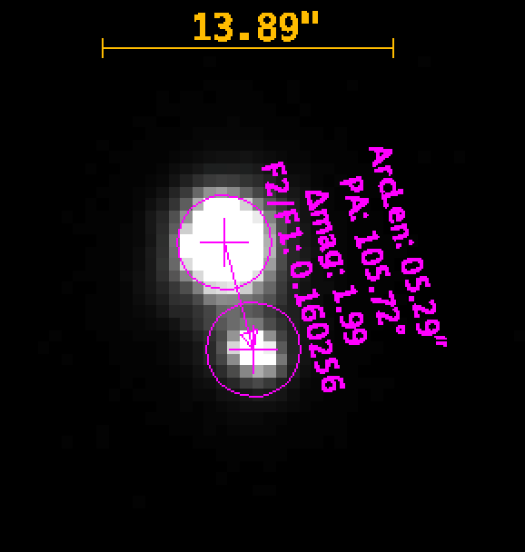

# Binary Star System Analysis: WDS 20136+5307

Peer-reviewed astrometry research that measured a double star's separation and position angle, then used historical and satellite data to test whether the two stars are physically bound.

| | |
|---|---|
| **Competency area** | Scientific data analysis and research communication |
| **Context** | Astronomy Research Seminar, Hastings College (undergraduate, team of five) |
| **Published** | Henderson, J., Ludwig, K., Smith, A., Allen, W., & Peterson, B. W. (2021). Observing Binary Star System (WDS) 20136+5307. *Journal of Double Star Observations, 17*(1), 68–71. |
| **Paper** | [binary-star-wds-20136-5307-paper.pdf](binary-star-wds-20136-5307-paper.pdf) |

## Problem

Two stars that look close together in the sky may be a true orbiting pair, or they may just line up from Earth's point of view. We measured the pair's current position and asked which case the evidence supports.

## Data

- **New observations:** ten 2.3-second CCD images taken on October 1, 2020 by a 0.4 m Las Cumbres Observatory telescope at Teide Observatory, Tenerife. Six of them were good enough to measure.
- **Historical measurements** going back to 1828, from the Washington Double Star Catalog (United States Naval Observatory).
- **Gaia DR2** parallax and proper-motion values for both stars.

## Methods

- Measured separation and position angle in AstroImageJ (4-pixel aperture, 15–20 pixel background annulus).
- Rejected four of ten images for poor focus or atmospheric smearing.
- Calculated means, standard deviations, and standard errors.
- Cleaned the historical record with a ±3σ clip, then weighted points by method (satellite > CCD > micrometer), by telescope resolution, and by number of nights observed.
- Plotted our measurement against the published orbit solution (Izmailov, 2019) and the historical positions (Plot Tool 3.19).
- Compared Gaia parallaxes and proper motions for the two stars.

## Key result

| | Separation | Position angle |
|---|---|---|
| Mean of six images | **5.21″** | **105.63°** |
| Standard error | 0.05″ | 0.15° |

The separation has narrowed from 5.40″ in 2015. The two stars have identical Gaia parallaxes (21.28 ± 0.03 mas), and their proper motions are close. Together with the orbit solution, this supports the conclusion that the stars are a **physically bound pair**, not a chance alignment.

## Tools

AstroImageJ, Plot Tool 3.19, the Washington Double Star Catalog, Gaia DR2, and spreadsheet-based error analysis.

## How to view

Open the [published paper (PDF)](binary-star-wds-20136-5307-paper.pdf). This project was measurement and analysis work, so there is no code to run.

## Limitations

- Six usable images from a single night.
- A quadratic (bound-orbit) fit matches the historical data, but more observations over time are needed to rule out a straight-line (unbound) path.

## Why it is in the portfolio

The work shows practices that carry straight into data science: judging data quality, cleaning and weighting a messy historical record, and stating a conclusion together with its uncertainty. It also went through formal peer review.
