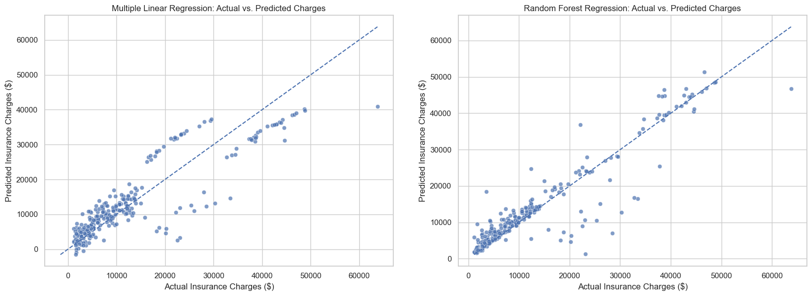

# Predicting Medical Insurance Charges with Regression

A comparison of linear regression and random forest regression for explaining and predicting annual medical insurance charges from six demographic and lifestyle traits.

| | |
|---|---|
| **Competency area** | Regression modeling and healthcare analytics |
| **Slides** | [View online](https://view.officeapps.live.com/op/view.aspx?src=https%3A%2F%2Fkeatonl2.github.io%2Fprojects%2Fmedical-insurance-cost-regression%2Fmedical-insurance-cost-regression-slides.pptx) · [Download PowerPoint, with speaker notes](medical-insurance-cost-regression-slides.pptx) |

## Problem

1. Which traits are most strongly associated with higher annual insurance charges?
2. How accurately can charges be predicted from those traits?

## Data

The Healthcare (medical insurance) dataset by P. Patil on Kaggle: 1,338 insured individuals, no missing values.

- **Predictors:** age, BMI, number of children, sex, smoking status, region
- **Target:** annual charges, ranging from $1,122 to $63,770 (mean $13,270, median $9,382, strongly right-skewed)

## Methods

- Kept the one duplicate row, since two people can share identical attributes.
- Split the data 80/20 with a fixed random seed (1,070 training rows, 268 test rows).
- One-hot encoded the categorical predictors, dropping the first level of each.
- Wrapped preprocessing and modeling in one scikit-learn pipeline, so both models see identical inputs and no test data leaks into training.
- Fit a **multiple linear regression** (interpretable baseline) and a **random forest** with 500 trees.
- Evaluated on the held-out test set with R², RMSE, and MAE. Checked for overfitting by comparing training and test R², and ran residual and predicted-against-actual diagnostics.

## Key results

| Metric (test set) | Linear regression | Random forest |
|---|---|---|
| R² | 0.784 | **0.864** |
| RMSE | $5,796 | **$4,603** |
| MAE | $4,181 | **$2,560** |

- The random forest cut typical error (MAE) by about 40%.
- **Smoking status** dominates: about 61% of random-forest feature importance, and roughly +$23,650 per year in the linear model with everything else held constant. **BMI** (22%) and **age** (13%) come next. Sex, children, and region add very little.
- The random forest overfits mildly (training R² 0.98, test R² 0.86). The linear model's residuals break its linearity and constant-variance assumptions, which points to a smoking × BMI interaction.

## Tools

Python, pandas, and scikit-learn (Pipeline, OneHotEncoder, LinearRegression, RandomForestRegressor), with matplotlib for the plots.

## How to run

<!-- TODO (Keaton): add the analysis notebook to this folder as `medical-insurance-cost-regression.ipynb`, then confirm these steps. -->

1. Download `insurance.csv` from the Kaggle Healthcare dataset (Patil) into this folder.
2. Install the requirements: `pip install pandas scikit-learn matplotlib jupyter`
3. Open and run the analysis notebook from top to bottom. The fixed random seed reproduces the results above.

## Limitations and ethics

- Only 1,338 records and six predictors. The data has no pre-existing conditions, income, or plan type.
- The results show association, not causation.
- A model that flags smokers as high-cost can be used to deny coverage as easily as to help people lower their risk. Models like this belong in decision support, not discriminatory pricing.

## Next steps

Log-transform charges, tune tree depth to reduce overfitting, and test a smoking × BMI interaction term.
