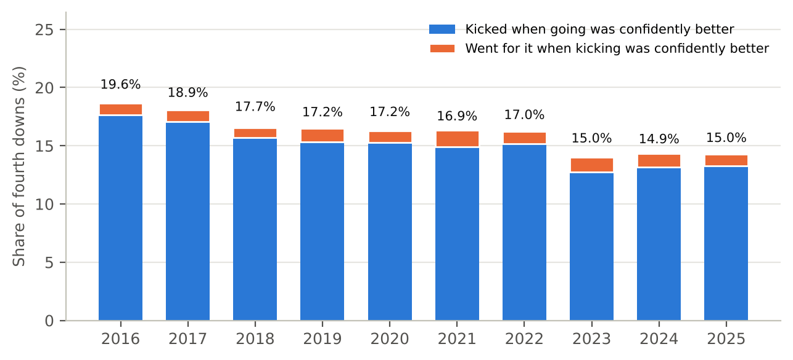

# Go For It: Predicting NFL Fourth-Down Conversions and Evaluating Coaching Decisions

An end-to-end study of the most second-guessed call in football. It predicts whether a fourth-down attempt converts, then combines those odds with win probability to judge whether teams' go, punt, and field-goal calls helped them win, and how that changed from 2016 to 2025.

| | |
|---|---|
| **Competency area** | Applied, end-to-end data science project development |
| **White paper** | [nfl-fourth-down-white-paper.pdf](nfl-fourth-down-white-paper.pdf) (17 pages) |
| **Presentation** | [Slides (PDF)](nfl-fourth-down-slides.pdf) · [PowerPoint with recorded narration](nfl-fourth-down-presentation.pptx) |
| **Audience Q&A** | [nfl-fourth-down-audience-qa.pdf](nfl-fourth-down-audience-qa.pdf) (answers to the ten questions an audience would most likely ask) |
| **Code** | [nfl-fourth-down-decisions.ipynb](nfl-fourth-down-decisions.ipynb) (full analysis, run top to bottom with saved outputs) |

## Problem

On fourth down a team can go for it, kick a field goal, or punt, and the coach owns the result. A staff needs two things to make that call well: trustworthy odds of converting, and a way to weigh those odds against the alternatives in terms of winning the game.

1. **RQ1:** Can pre-snap information predict a conversion better than a baseline that uses yards to go alone?
2. **RQ2:** Which factors still matter once distance is accounted for?
3. **RQ3:** When conversion odds are combined with win probability, how often did teams choose an option that was confidently worse than the best one, and did that share fall from 2016 to 2025?

## Data

**nflverse play-by-play releases, 2016–2025** (CC BY 4.0). The notebook downloads one file per season on its first run.

- **484,254** plays from **2,761** regular-season and postseason games, with no duplicate game-play keys. The in-progress 2026 season is excluded.
- **39,358** fourth downs that ended in a run, pass, punt, or field goal. This drops penalty-nullified snaps, kneels, and spikes.
- **6,785** genuine go-for-it attempts (53.1% converted), after setting aside 264 fake punts and fake field goals.
- **402,950** plays used to train the win-probability model.
- Preparation: the point spread was converted to the offense's view, indoor weather was set to 70°F and 0 mph, the 420 outdoor attempts with missing weather got the season median plus a missing-value flag, and tied games were dropped from the win-probability labels. Every step and its row count is logged in the notebook and Appendix A1 of the white paper.

## Methods

- **Conversion models (RQ1, RQ2).** A distance-only baseline (the observed rate at each yards-to-go value) against logistic regression with splines, a random forest, and XGBoost. Neural networks were ruled out because fewer than 7,000 attempts give them too little to learn from.
- **Time-aware validation.** Strictly by season: tuned on 2024 after training on 2016–2023, refit on 2016–2024, and tested once on 2025. Forward-chaining validation repeated this for 2021–2025.
- **Scoring.** Brier score and log loss as primary metrics, calibration curves, AUC, a game-level bootstrap to test whether gains over the baseline were real, and permutation importance for RQ2.
- **Decision engine (RQ3).** For each of 39,102 regulation fourth downs, the win probability of going, kicking, and punting, from a monotonic XGBoost win-probability model, a field-goal model, punt-outcome distributions, the yards gained on conversions, each season's kickoff starting position, and the distance-only conversion odds.
- **Uncertainty.** Every component was refit on 50 game-level bootstrap samples. A call counts as a confident mistake only when at least 90% of the refits agree another option was better. Calls in between are toss-ups.
- **Robustness.** Confidence thresholds from 75% to 95%, conversion odds shaded down 5 and 10 points to mimic selection bias, the 2024–2025 kickoff rule changes, and team-season aggregation.

## Key results

| Conversion model, 2025 test season | Brier | Log loss | AUC |
|---|---|---|---|
| Baseline (yards to go only) | 0.2295 | 0.6513 | 0.641 |
| Logistic regression (splines) | 0.2259 | 0.6428 | 0.659 |
| Random forest | 0.2272 | 0.6456 | 0.653 |
| XGBoost (selected on 2024) | 0.2267 | 0.6443 | 0.654 |

- **RQ1: Distance is most of the story.** Every model beat the baseline's Brier score, but only slightly. XGBoost improved it by 1.2%, the 95% bootstrap interval for that gain included zero, and it beat the baseline in only three of five forward-chaining seasons. H1 was not supported.
- **RQ2: Yards to go dominates, and the play call matters.** Shuffling yards to go hurt the model about 15 times more than any other feature, and weather added nothing. On fourth-and-1, runs converted **70.3%** of the time (n = 1,969) against **58.0%** for passes (n = 762). H2 was partly supported.
- **RQ3: Confident mistakes fell, but about one call in seven is still wrong.** The share of confidently suboptimal decisions fell from **19.6% in 2016 to 15.0% in 2025**. **88.7%** of them were kicks when going was better, at a median cost of 2.1 win-probability points each. In 2025 they cost the average team about **0.46 expected wins** a season (0.70 in 2016). H3 was supported.
- **The findings are robust.** The decline holds at every confidence threshold from 75% to 95%, with conversion odds shaded down 10 points (the model still favors going on 80% of fourth-and-1 situations), and under the new kickoff rules. **27 of 32 teams** cut their share of confident mistakes between 2016–18 and 2023–25.
- **Recommendation:** go for it on fourth-and-1 almost everywhere, use a distance table rather than a complex model for conversion odds, account for the new kickoff when weighing a long field goal, and treat toss-ups as coaching judgment calls rather than analytics mandates.

## Tools

Python, pandas, NumPy, scikit-learn (logistic regression with `SplineTransformer`, `RandomForestClassifier`, calibration, `permutation_importance`), XGBoost with monotonic constraints, matplotlib, and game-level bootstrap resampling.

## How to run

The notebook has every cell's saved output, so GitHub shows the full workflow without running anything.

To reproduce it:

1. `pip install -r requirements.txt`
2. Open `nfl-fourth-down-decisions.ipynb` and run all cells. On the first run it downloads the ten nflverse season files into a `data/` folder (set `PBP_DIR` to use another folder) and writes figures to `figures/`.
3. The full run takes about 5 minutes with the fixed seed (680) and reproduces every number in the white paper, slides, and Q&A.

### Files in this folder

| Path | What it is |
|---|---|
| `nfl-fourth-down-decisions.ipynb` | Full analysis: data preparation, conversion models, decision engine, bootstrap, robustness checks, team results |
| `figures/` | The six figures used in the white paper and slides |
| `nfl-fourth-down-white-paper.pdf` | Final white paper |
| `nfl-fourth-down-slides.pdf` | Presentation slides |
| `nfl-fourth-down-presentation.pptx` | The same slides with recorded narration and speaker notes |
| `nfl-fourth-down-audience-qa.pdf` | Answers to ten audience questions |
| `requirements.txt` | Python packages needed to rerun it |

## Limitations and ethics

- Teams choose when to go for it, so conversion odds are least certain where teams rarely try. The stress test bounds this risk but cannot remove it.
- The win-probability model is flatter than expected near the goal line. Personnel, injuries, specific kickers, and opponent tendencies are not in the data, overtime is excluded, and only two seasons of the new kickoff rule exist.
- Teams with fewer confident mistakes also won more often (r = −0.47), but the link is not causal, since roster strength and coaching quality move together.
- Every verdict is reported with bootstrap confidence and toss-ups are shown, so no single call is overstated. Teams appear only in aggregate, with no coach-level rankings, and the work is framed as team decision support rather than betting picks.
