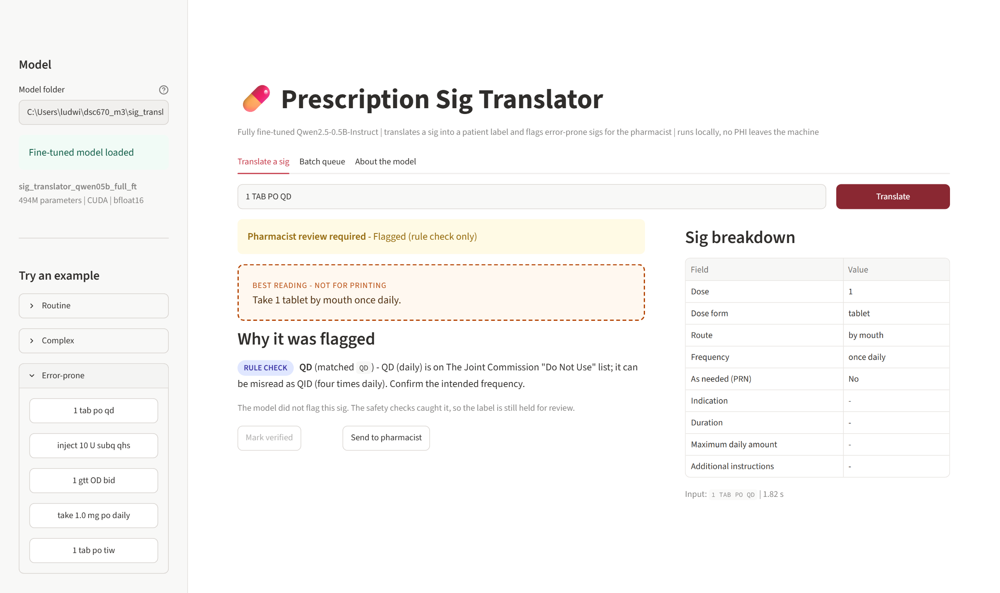

# Prescription Sig Translator: Fine-Tuning a Small Language Model for Pharmacy Safety

A fully fine-tuned Qwen2.5-0.5B-Instruct model that turns pharmacy shorthand ("sigs" such as `1-2 tabs PO q4-6h PRN pain, max 8/day`) into the plain-English sentence printed on a patient's label. When a sig uses an error-prone abbreviation such as `QD` or `OD`, the model flags it for the pharmacist instead of guessing. It runs locally in a Streamlit app.

| | |
|---|---|
| **Competency area** | Generative AI applications |
| **Context** | Graduate generative AI course project, built in three stages: a prompting study, a full fine-tune, and an app |
| **App** | [app.py](app.py) + [sig_engine.py](sig_engine.py) (Streamlit) · [screenshots](screenshots/) |
| **Code** | [prescription-sig-translator-fine-tuning.ipynb](prescription-sig-translator-fine-tuning.ipynb) (dataset build, baselines, full fine-tune, evaluation, error analysis, with saved outputs) |
| **Presentation** | [prescription-sig-translator-presentation.pdf](presentation/prescription-sig-translator-presentation.pdf) (16 slides) · [.pptx](presentation/prescription-sig-translator-presentation.pptx) |



## Problem

Every prescription carries a sig, the prescriber's coded direction, which pharmacy technicians like me translate into the label sentence. The shorthand is a known source of medication errors: `QD` (daily) and `QID` (four times daily) differ by one letter and a factor of four, which is why the ISMP and The Joint Commission publish lists of abbreviations to avoid. Lookup tables in dispensing software expand common codes, but they translate error-prone ones confidently and wrongly.

The goal: given one sig (no drug name, strength, or patient data), return a field-by-field breakdown, a patient sentence, and a list of anything a pharmacist must confirm. Success is measured mainly by **critical errors**: a confidently wrong label, meaning a safe sig mistranslated or an error-prone sig translated without a flag. An awkward but correct sentence is a minor problem.

## Data

**MIMIC-IV Clinical Database Demo v2.2** (Johnson et al., 2023, PhysioNet, Open Database License). It is the open-access subset of MIMIC-IV: 100 de-identified patients from Beth Israel Deaconess Medical Center. No public dataset of pharmacist-approved sigs exists, so I built one.

- Joined the `prescriptions` table (dose, form, route) with the `pharmacy` table (frequency code) to get **18,087** real medication orders.
- Kept the **6,587** orders that map to a retail sig. IV, IM and tube orders, and doses that can't go on a label, were dropped.
- Built **845** examples (676 train / 84 validation / 85 test) in three groups: **560 routine** sigs from real orders, **120 complex** sigs (tapers, loading doses, dose ranges with daily maximums), and **165 error-prone** sigs (11 each of 15 ISMP / Joint Commission types).
- Every label field is filled from the structured order, so labels are correct by construction rather than written by a model. Sigs are written in mixed formats on purpose (`qd`, `QD`, `q.d.`).
- **126** generated sigs were removed because they matched a hand-written test input, so the test set is never memorized.

The generated training files are in [data/](data/). They are derived from the MIMIC-IV demo and shared under the same Open Database License.

## Methods

- **Prompting study first.** Five prompt experiments on Qwen2.5-0.5B and 3B, scored on 18 hand-written test sigs plus 10 rewrites, typos, and nonsense inputs. No prompt taught the model *when* to flag: even the 3B model flagged 0% of error-prone sigs.
- **Output schema.** A fixed 12-field JSON label, so most scoring is mechanical and only the patient sentence is subjective. A reply that doesn't parse, misses a field, or has a wrong type counts as invalid.
- **Full fine-tune, no LoRA.** All 494 million parameters of Qwen2.5-0.5B-Instruct. AdamW, learning rate 2e-5 with linear decay, 3 epochs, effective batch 16, loss on the answer only, bf16 on an RTX 5080 (12.2 GB peak, 3.3 minutes). The model sees only a one-sentence system prompt, so the flagging rules must be learned from the data.
- **Baselines.** A rule-based lookup table, and the base 0.5B and 3B models with the best prompt from the study.
- **Evaluation.** Critical errors (primary), flag precision / recall / F1, field-level exact match, BLEU and ROUGE-L, and an error analysis where I read the outputs myself.
- **App.** The Streamlit app adds safety layers on top of the model: schema validation, a regex scan of the raw sig for ISMP / Joint Commission abbreviations, and a consistency check for labels that mention a body site or route the sig never implied. Any one of them holds the label for review.

## Key results

| System | Critical errors, held-out (n = 85) | Critical errors, hand-written suite (n = 28) | Flag F1 |
|---|---|---|---|
| Lookup table | 18 | 12 | 0.000 |
| Base 0.5B + best prompt | 41 | 9 | 0.380 |
| Base 3B + best prompt | 27 | 9 | 0.182 |
| **Fine-tuned 0.5B** | **3** | **3** | **0.880** |

- **Fine-tuning taught the model to stop and flag.** On the hand-written suite it caught 7 of 8 error-prone abbreviations plus the typo and the nonsense input. False flags on safe sigs fell from 50% to 5%.
- **Training was clean.** Validation loss fell from 1.947 to 0.0027 with almost no train-validation gap, and token accuracy rose from 61.3% to 99.9%.
- **The remaining errors were missed flags.** Uppercase `QD` was translated as "once daily" all 3 times it appeared, because only one training example had it in capitals. The app's rule check now catches it: in the screenshots, the model misses `1 TAB PO QD` and the rule check holds the label.
- **Reading the outputs mattered.** The automated scorer passed a nitroglycerin label that turned "3 doses in 15 minutes" into "3 tablets per day", and the model sometimes invents a plausible flag reason. Neither shows up in the metrics.

## Tools

Python, PyTorch, Hugging Face Transformers (Trainer, full fine-tuning), Qwen2.5-0.5B-Instruct and 3B-Instruct, pandas, scikit-learn (precision, recall, F1), sacrebleu, rouge-score, matplotlib, Streamlit, regular expressions for the safety checks.

## How to run

**Read without running.** The notebook has every cell's saved output, so GitHub shows the full workflow. The [screenshots](screenshots/) show the app running with the fine-tuned model.

**Run the app.** The fine-tuned model is about 2 GB, too large for this repository. Recreate it with the notebook, then:

```bash
pip install -r requirements.txt     # for an NVIDIA GPU, install the CUDA build of torch first
# put the sig_translator_qwen05b_full_ft/ folder next to app.py, or set SIG_MODEL_DIR to its path
streamlit run app.py
```

The app runs on CPU or GPU, about 2–4 seconds per sig on an RTX 5080.

**Recreate the model.** Open `prescription-sig-translator-fine-tuning.ipynb` and run all cells on a CUDA GPU with about 16 GB of memory. It downloads the MIMIC-IV demo tables, builds the dataset, runs the baselines, fine-tunes, and saves `sig_translator_qwen05b_full_ft/`.

### Files in this folder

| Path | What it is |
|---|---|
| `app.py` | Streamlit interface: single sig, batch queue, and model information tabs |
| `sig_engine.py` | Model loading, inference, schema validation, safety checks, review decision |
| `requirements.txt` | Packages needed to run the app |
| `prescription-sig-translator-fine-tuning.ipynb` | Dataset build, baselines, full fine-tune, evaluation, and error analysis |
| `data/` | Train, validation, and test sets in chat-format JSONL |
| `results/` | Evaluation summary, flag F1 and field accuracy, every model output, training metrics and loss curves |
| `screenshots/` | The app running with the fine-tuned model |
| `presentation/` | Slides (PDF and .pptx) and the script that builds them |

## Limitations

- The training data comes from a hospital database of 100 patients, so inhalers, eye drops, and topical sigs are rare and ear drops are missing.
- The held-out split shares a generator with the training data. The hand-written suite is the more honest test, and it has only 28 sigs.
- Two identical training runs differed by one to two critical errors because GPU training is not bit-for-bit reproducible.
- The model can write a confident but false flag reason, and the scorer checks that facts appear, not that they are attached to the right thing.
- No real patient data was used. This is a drafting and flagging aid: a pharmacist verifies every label, and nothing flagged ever prints on its own.
