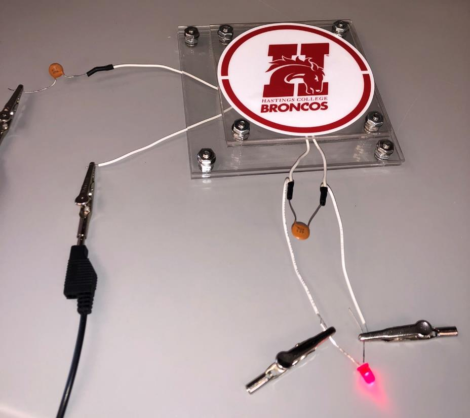

# Wireless Power Transfer: Designing a Near-Field System

A hardware research project. I designed, built, and tested a resonant inductive coupling system, measured how efficiently it transfers power, and reviewed why far-field wireless power is still impractical for everyday devices.

| | |
|---|---|
| **Competency area** | Experimental research and quantitative analysis |
| **Context** | Senior physics research project, Hastings College Physics Department (2022) |
| **Paper** | [wireless-power-transfer-paper.pdf](wireless-power-transfer-paper.pdf) (40 pages) |

## Problem

Wireless charging works across a few millimeters and fails across a room. The project asked:

1. What does it take to build a near-field system that transfers power efficiently, and how close can a small custom build get to the commercial Qi standard?
2. How fast does efficiency fall as the coils move apart?
3. What keeps far-field (long-distance) transmission from being practical today?

## Data

- **Measurements from my build:** coil inductance with and without ferrite plates, self- and mutual inductance, coil resistance, oscilloscope traces of the drive signal, and LED output as the coil gap increased in 0.1 cm steps.
- **Manufacturer data:** the Würth Elektronik coil datasheet (resonant frequency, rated Q and inductance).
- **Published literature** on near-field and far-field transmission and the Wireless Power Consortium's Qi standard.

## Methods

- Salvaged Qi-rated coils from two commercial 10 W charging pads, chosen for their low resistance (stranded wire avoids the skin effect).
- Tested whether ferrite plates raise inductance. They did, from 55.2 µH to 60.4 µH on test coils.
- Measured self-inductance at the 125 kHz resonant frequency (22.1 µH, against a rated 24 µH) and sized the resonant capacitors (57.3 nF): one in series on the transmitter and one in parallel on the receiver.
- Calculated the quality factor *Q*, the coupling factor *k*, and the figure of merit *Q·k* to confirm the system sat in the low-loss zone before building the drive circuit.
- Built a PWM H-bridge drive circuit (555 timer, buffer inverter, MOSFET drivers and gates) and used an oscilloscope to verify it turned a 12 V DC supply into a sinusoidal AC drive signal.
- Calculated power-transfer efficiency (PTE) from the measured parameters, then repeated the measurement as the coil gap grew to map PTE against coupling.

## Key results

| Quantity | Measured or calculated | Reference |
|---|---|---|
| Quality factor *Q* | **162.2** | Manufacturer rating 180 |
| Coupling factor *k* | **0.202** | |
| Figure of merit *Q·k* | **32.76**, loss factor ≈ 0.08 (low-loss zone) | |
| Power-transfer efficiency | **82.03%** (theoretical, from measured parameters) | Qi standard ≥ 85% |
| Maximum working gap (LED lit) | **≈ 3.2 cm** | Qi near-field range ≈ 4 cm |

The system worked. It powered an LED wirelessly at an efficiency just under the commercial Qi standard, which is a strong result for a hand-built design without the integrated control chips commercial chargers use. Efficiency held up well until the coupling factor fell to about 0.2 and then dropped quickly, which is why near-field charging only works over a few centimeters. The PWM drive circuit was essential. It pushed more current into the transmitter coil, and without it the PTE would have been far lower.

The far-field review found that interference, efficiency, and system cost are what currently hold back long-distance power beaming.

## Tools

Oscilloscope, voltmeter, and lab power supplies. Soldered resonant LC circuits and a PWM H-bridge (TLC555, 74HC4049, IR2113, IRLZ44N). Electromagnetic theory for *Q*, *k*, and PTE calculations. The Qi wireless charging standard. The project also included a materials budget ($920) and a Gantt-chart schedule.

## How to view

Read the [full paper (PDF)](wireless-power-transfer-paper.pdf). This was a hardware and analysis project, so there is no code to run.

## Limitations

- PTE is calculated from measured circuit parameters, not from direct input and output power meters.
- It is one prototype with an LED load, so the results describe this design rather than near-field systems in general.
- Far-field conclusions come from the literature, not from a far-field build.

## Why it is in the portfolio

It predates my graduate coursework, but it shows the habits I still use: turn theory into measurable parameters, check measurements against a reference, compare the result honestly with a standard, and explain it to a technical audience.
